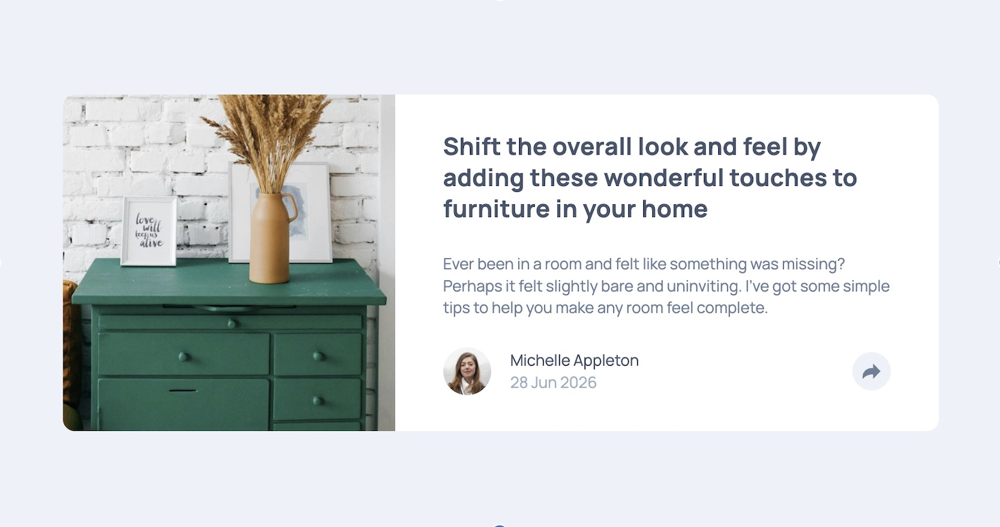

# Frontend Mentor - Article preview component solution

This is a solution to the [Article preview component challenge on Frontend Mentor](https://www.frontendmentor.io/challenges/article-preview-component-dYBN_pYFT). Frontend Mentor challenges help you improve your coding skills by building realistic projects.

## Table of contents

- [Overview](#overview)
  - [The challenge](#the-challenge)
  - [Screenshot](#screenshot)
  - [Links](#links)
- [Author](#author)

## Overview

### The challenge

Users should be able to:

- See the social media share links when they click the share icon
- View the optimal layout for each page depending on their device's screen size
- See hover states for all interactive elements on the page

### Screenshot

### Links

- Solution URL: [https://www.frontendmentor.io/solutions/article-preview-component-pUC85RZtuc](https://www.frontendmentor.io/solutions/article-preview-component-pUC85RZtuc)
- Live Site URL: [https://alexisborron.github.io/article-preview-component/](https://alexisborron.github.io/article-preview-component/)

## Author

- Frontend Mentor - [@alexisborron](https://www.frontendmentor.io/profile/alexisborron)
